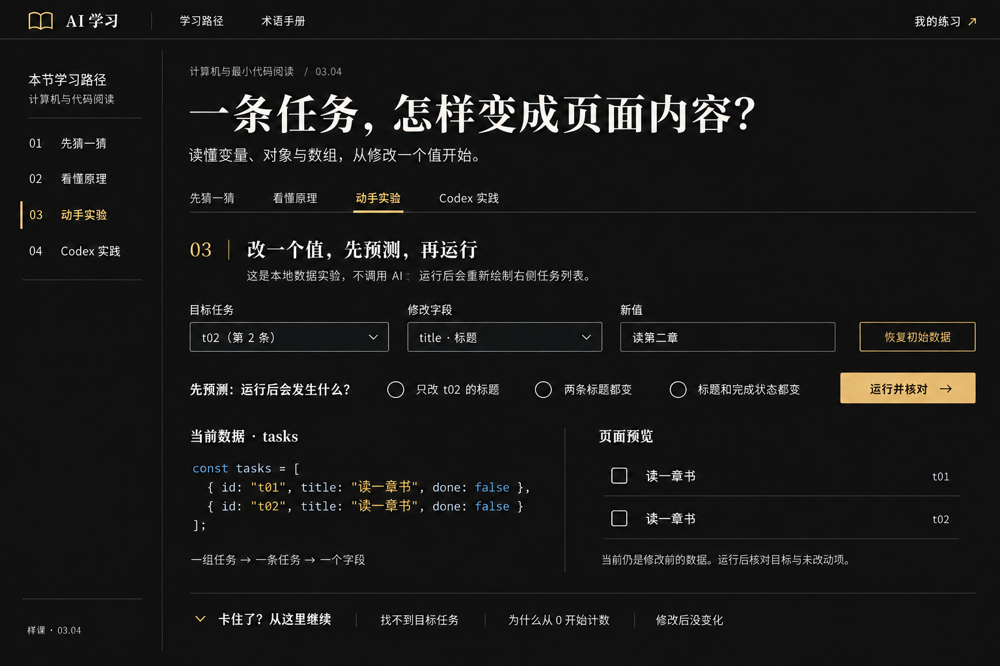

# 03.04 样课实验区原型说明

状态：用户已确认视觉原型；交互网页与独立练习已实现。日期：2026-10-15。真实 Codex 桌面配图未采集，当前工具未提供可用的原生应用窗口。

## 视觉原型



这是学习网站的生成式视觉原型，不是浏览器运行截图，也不是 Codex 实操截图。使用内置 imagegen 工具，沿用已确认的 [黑金视觉](ai-learning-approved.png) 与 [现有样课](../../ai-learning-mvp/assets/mvp-desktop.jpg)。首次生成后只修正了课程归属文字；有效参考为 v2 图。

主标题：一条任务，怎样变成页面内容？副标题：读懂变量、对象与数组，从修改一个值开始。

与既有设计一致：连续近黑阅读面、暖白文字、少量金色强调、窄侧栏、衬线标题与无衬线正文，无独立右侧栏。代码与预览为同一教学实验里的两列，使用细线分隔，不扩成多面板工作台。代码可使用克制的语法着色。

原型展示“动手实验”的默认状态：目标 t02、待改标题“读第二章”，但尚未运行。因此当前数据与预览中两条任务的标题仍都是“读一章书”，预测没有预选。

完整 [样课内容稿](../curriculum/lessons/03-04-variables-objects-arrays.md) 包含另三个学习环节；它们沿用已有样课的题目、连续正文、实操说明与帮助形式，本轮不扩展其他课程或设计方向。

## 实验的操作与状态

### 所有实验共同遵守

- 明确标注本地确定性教学实验，不调用 AI，不执行自由输入的代码。输入字符串按文本显示。
- 修改目标、字段或输入值属于准备操作；数据和预览在运行前保持不变，旧预测与反馈清除，避免用上次结果判断这次操作。
- 先选预测再运行；未选择时给文字提示。猜错仍执行有效操作，并根据所选误区解释差异。
- 显示实际变化及未改动项；失败输入不能先改变部分数据，再声称失败。
- 恢复按钮恢复固定的两个独立对象，清空本轮预测与反馈。它只恢复实验数据，不删除其他样课的记录。
- 任务数据仅存在本次页面会话中，刷新回到初始数据；学习进度采用独立命名空间。必须明确说明两种保存范围。
- 学习环节、阅读状态、概念自检与实操自行验收分别记录；复制提示词或看图不能自动判定真实实操通过。

### 四个小实验

| 任务 | 操作与真实变化 | 核对依据 |
| --- | --- | --- |
| 改标题 | 按 ID 修改 t02.title | 只变目标标题；两个 ID、done、数量和另一条保持。 |
| 改状态 | 用明确两态选择修改 t01.done | 只变目标布尔值和对应完成显示，标题保持；显示文字状态。 |
| 加记录 | 加入给定 t03、整理桌面、未完成 | 数量加一，原有记录保持；重复 ID、空标题拒绝且不改变数据。 |
| 调序后修改 | 交换两条位置，再按 t02 修改 | 身份与当前位置分开核对；按索引的对照演示使用独立副本。 |

四项在同一实验区依次展开；后续任务完成第一项后出现入口，保持每次只处理一个小目标。完成选项切换与录入后需要重新预测。原型只展示第一项默认画面，不声称其他状态已有截图。

## 卡点帮助与窄屏处理

帮助放在当前实验之后，按定位提示、相关解释、完整演示逐步展开；内容包含找目标、零起点索引、草稿未运行、显示未更新和恢复。

窄屏沿用既有课程抽屉与单列规则：操作控件依次排列，当前数据在预览之前；短代码使用可换行排版，避免挤出页面。无需缩小正文到难以阅读。标签、预测题组、反馈、焦点与状态变更提供语义和文字说明。已在 1536×1024 桌面与 390×844 手机视口检查实际网页，未发现页面横向溢出。

## 实操材料与下一阶段范围

已在现有样课目录新增 data-literacy.html 与独立练习文件，保留上下文样课及其历史存储键。正文、四个实验、帮助、预测反馈、自检、隔离的学习记录与目录抽屉已实现，并经过浏览器与回归验证。

Codex 实操须使用本例的真实操作图，分别解释读文件、改字段、运行核对、调序后验证。当前未采集，不用这张生成图或上一课的官方通用演示替代。可取得的产品说明已通过 [OpenAI 官方文档](https://learn.chatgpt.com/docs/code-review?surface=app) 核对，具体界面需要实际取材。

## 本轮检查记录

- 已对照批准原型、现有样课与新图检查背景、金色、标题字形、侧栏、主要控件、代码和预览的对应关系。
- 初版遗留的旧课归属已通过局部图像编辑更正为“计算机与最小代码阅读 / 03.04”。
- 教学代码的实际执行结果由 [例子验证测试](../curriculum/lessons/tests/data-literacy-examples.test.cjs) 核对；测试不证明交互网页或真实 Codex 操作已完成。
- 生成提示词保存在 [prompt 记录](data-literacy-03-04-prompts.txt)，供后续追溯。

从工作区根目录运行：

```powershell
node --test docs/curriculum/lessons/tests/data-literacy-examples.test.cjs ai-learning-mvp/tests/core.test.cjs
```

本轮运行结果：6 项内容例子测试、8 项现有样课回归测试，共 14 项通过。另检查了文档相对链接、代码块、四个学习环节与帮助/自检结构。后续实现检查覆盖四实验、错误预测、空输入、重复 ID、文本显示、帮助、复制、完成与刷新恢复、窄屏目录；新增 9 项核心行为测试。
